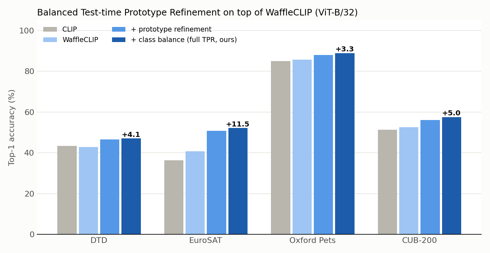

# Balanced Test-time Prototype Refinement (TPR) for WaffleCLIP

**One-line summary:** a ~15-line, training-free add-on that (1) stops CLIP from over-predicting a few "popular" classes and (2) moves each class's text embedding toward where that class's *images* actually sit in CLIP space. On top of WaffleCLIP it improves top-1 accuracy by **+6.0 points on average** over four of the paper's benchmarks (up to **+11.5** on EuroSAT), with no labels, no training and no extra prompts.



---

## 1. Background: what WaffleCLIP does

CLIP classifies an image by comparing its embedding with one text embedding per class (e.g. "A photo of a golden retriever."). The class with the highest similarity wins.

WaffleCLIP (Roth et al., ICCV 2023) showed that you can match LLM-generated class descriptions by averaging many prompts with **random words and characters** appended ("A photo of a golden retriever, which has jmhj, !J#m."). Every improvement in the paper happens **on the text side only**.

## 2. Two problems that better prompts cannot fix

* **(a) Modality gap.** Text and image embeddings occupy different regions of CLIP's space. A class's text embedding points roughly in the right direction, but it is not where that class's photos actually cluster.
* **(b) Class bias.** CLIP has favourite classes. On EuroSAT, for example, it puts far too many images into a few classes and almost none into others, even though the test set is roughly balanced.

Both are properties of how the *images* fall in CLIP space, so tweaking prompts (GPT descriptions, Waffle noise, concepts) cannot fix them.

## 3. Our idea

We use the test images themselves, without their labels:

1. Classify all test images with the normal (Waffle) text prototypes. This gives a **soft pseudo-label** for each image.
2. **Class balance (fixes b):** if a class is receiving too many images, lower its score a little, and raise the score of classes receiving too few. (This is Sinkhorn balancing written as one score offset per class.)
3. **Prototype refinement (fixes a):** for each class, take the pseudo-label-weighted average of the image embeddings. This **image prototype** sits where that class's images really are.
4. New prototype = text prototype + alpha × image prototype. Repeat a few times, then classify with the new prototypes and the balance offset.

The text prototype keeps the meaning of the class, the image prototype corrects its position, and the balance offset removes the bias.

### The entire method ([improvement.py](improvement.py))

```python
def class_balance(logits, iters=3):
    """Per-class score offset: classes that get too much probability are pushed down."""
    bias = torch.zeros(logits.shape[1], device=logits.device)
    for _ in range(iters):
        bias = bias - (logits + bias).log_softmax(dim=-1).logsumexp(dim=0)  # = log(total prob. per class)
    return bias

def refine_prototypes(text_protos, image_embs, alpha=1.0, steps=3, temperature=100.0, balance=True):
    text_protos = F.normalize(text_protos.float(), dim=-1)
    image_embs = F.normalize(image_embs.float(), dim=-1)
    protos = text_protos
    for _ in range(steps):
        logits = temperature * image_embs @ protos.T
        if balance:
            logits = logits + class_balance(logits)
        probs = logits.softmax(dim=-1)                                   # soft pseudo-labels
        image_protos = F.normalize(probs.T @ image_embs, dim=-1)        # class centroids in image space
        protos = F.normalize(text_protos + alpha * image_protos, dim=-1)
    bias = class_balance(temperature * image_embs @ protos.T) / temperature if balance else 0
    return protos, bias
```

`temperature=100` is CLIP's own logit scale. It is applied with one flag: `python base_main.py ... --refine`.

### Changes to the original code (minimal)

| File | Change |
|---|---|
| `improvement.py` | **new**: the method above |
| `base_main.py` | +4 argparse flags; +5 lines that swap each class's prompt set for its refined prototype; +2 lines that add the balance offset to the scores. All original modes still run unchanged when `--refine` is not set. |
| `waffle_tools.py` | dataset paths changed to `./data/...` (needed to run at all) |
| `base_main.py`, `datasets.py` | 2 one-line Windows fixes (DataLoader workers, path separator) |
| `run_benchmark.sh`, `make_figure.py` | **new**: benchmark script and figure |

---

## 4. Experimental setup

* **Backbone:** CLIP ViT-B/32, as in the paper's main table.
* **Datasets (test splits, from the paper):** DTD (textures, 47 classes), EuroSAT (satellite, 10), Oxford Pets (37), CUB-200 (birds, 200).
* **Methods:** CLIP, DCLIP (GPT descriptions), WaffleCLIP (15 word/char pairs, **7 random seeds**, mean ± std), and WaffleCLIP + concepts, each run three ways: original, + refinement only (`--refine --refine_balance=0`), and + full TPR (`--refine`).
* **One fixed setting for every dataset and method:** alpha = 1, steps = 3, picked after a small DTD-only sweep of the first (unbalanced) version. There is no per-dataset tuning. A sensitivity study follows in section 6.
* **Reproduction check:** our baselines closely match the paper (CLIP: DTD 43.40 vs 43.14, Pets 84.98 vs 85.06, CUB 51.31 vs 51.28; WaffleCLIP + concepts on Pets: 87.51 vs 87.52). EuroSAT is lower (CLIP 36.34 vs 40.76), probably because torchvision now downloads a different copy of EuroSAT. All methods use the same data, so every comparison below is fair.

Reproduce: `bash run_benchmark.sh <python>` → `results/benchmark.csv`, then `python make_figure.py`.

## 5. Main results (top-1 accuracy %, ViT-B/32)

| Method | DTD | EuroSAT | Pets | CUB | **Avg** |
|---|---|---|---|---|---|
| CLIP | 43.40 | 36.34 | 84.98 | 51.31 | 54.01 |
| CLIP + refinement only | 48.62 | 46.88 | 86.37 | 55.76 | 59.41 |
| **CLIP + TPR** | **48.94** (+5.5) | **49.47** (+13.1) | **88.31** (+3.3) | **57.15** (+5.8) | **60.97** (+7.0) |
| DCLIP (GPT descriptions) | 44.36 | 41.52 | 86.45 | 52.62 | 56.24 |
| DCLIP + refinement only | 47.55 | 49.90 | 88.23 | 56.01 | 60.42 |
| **DCLIP + TPR** | **48.30** (+3.9) | **53.15** (+11.6) | **89.07** (+2.6) | **57.42** (+4.8) | **61.99** (+5.8) |
| WaffleCLIP | 42.91 ±0.42 | 40.70 ±1.33 | 85.63 ±0.18 | 52.48 ±0.18 | 55.43 |
| WaffleCLIP + refinement only | 46.64 ±0.16 | 50.74 ±0.36 | 87.93 ±0.19 | 56.07 ±0.04 | 60.35 |
| **WaffleCLIP + TPR** | **47.03** ±0.29 (+4.1) | **52.18** ±0.31 (+11.5) | **88.93** ±0.09 (+3.3) | **57.49** ±0.09 (+5.0) | **61.41** (+6.0) |
| WaffleCLIP + concepts | – | 47.42 ±0.79 | 87.51 ±0.06 | 52.80 ±0.22 | – |
| WaffleCLIP + concepts + refinement only | – | 47.51 ±0.24 | 85.66 ±0.09 | 56.27 ±0.06 | – |
| **WaffleCLIP + concepts + TPR** | – | 47.15 ±0.34 (−0.3) | **88.28** ±0.63 (+0.8) | **57.33** ±0.09 (+4.5) | – |

(The paper gives no concept prompt for DTD.)

**Takeaways**

* TPR improves **all three base methods on all four datasets**, by +2.6 to +13.1 points. That's 12 of 12 settings.
* **Class balance adds to refinement in 14 of 15 settings**, and it **fixes refinement's one failure case**: Pets + concepts goes from −1.9 (refinement only) to +0.8.
* The gains are far larger than the seed noise: WaffleCLIP's std is at most 1.3, and TPR also *reduces* the variance across random Waffle draws (EuroSAT std 1.33 → 0.31).
* **Plain WaffleCLIP + TPR (61.4 avg) beats DCLIP (56.2)** with no GPT queries at all, and beats WaffleCLIP + GPT-chosen concepts on all three datasets that have concepts.
* The biggest gains come where prompts carry the least information (EuroSAT satellite images, DTD textures), which is where the modality gap and class bias hurt most.

## 6. Ablations

### What contributes what? (WaffleCLIP, 4-dataset average)

| Variant | Avg | Δ |
|---|---|---|
| WaffleCLIP | 55.43 | – |
| + normalise prototype only (alpha = 0, no balance) | 54.36 | −1.1 |
| + refinement only | 60.35 | +4.9 |
| + full TPR (refinement + balance) | **61.41** | **+6.0** |

Normalising alone does not help (DTD 42.80, EuroSAT 37.10, Pets 85.73, CUB 51.80), so the gain comes from the image-side ideas, not from a side effect of the code.

### Sensitivity to alpha and steps (full TPR, WaffleCLIP, mean of 3 seeds)

| (alpha, steps) | baseline | (0,1) = balance only | (0.5,1) | (0.5,3) | (1,1) | **(1,3) used** | (1,5) | (2,3) |
|---|---|---|---|---|---|---|---|---|
| DTD | 42.85 | 46.79 | 48.56 | 47.94 | 48.14 | 46.99 | 46.79 | 45.35 |
| EuroSAT | 40.57 | 51.53 | 56.91 | 54.75 | 56.47 | 52.40 | 52.13 | 50.40 |
| Pets | 85.66 | 89.23 | 89.85 | 90.14 | 89.57 | 89.01 | 88.68 | 86.07 |
| CUB | 52.53 | 55.45 | 57.20 | 57.54 | 57.40 | 57.46 | 57.31 | 56.44 |
| EuroSAT + concepts | 47.69 | 48.41 | 51.60 | 49.28 | 51.44 | 47.41 | 46.44 | 44.92 |
| Pets + concepts | 87.51 | 89.22 | 89.28 | 89.41 | 89.00 | 88.08 | 87.95 | 84.76 |
| CUB + concepts | 52.72 | 55.72 | 57.59 | 57.99 | 57.53 | 57.36 | 57.46 | 55.96 |

* **Every setting tried improves every plain-WaffleCLIP dataset**, so the method is not fragile.
* **Balancing alone (alpha = 0) is already a strong, one-function improvement.** Adding refinement on top gives the most.
* **The setting we report (1,3) is *not* the best one.** Gentler settings such as (0.5,1) or (1,1) are higher almost everywhere (e.g. EuroSAT 56.9 vs 52.4). We fixed (1,3) before this sweep (from the DTD sweep above) and did not change it afterwards, because choosing hyper-parameters by test accuracy would be test-set tuning. The main-table numbers are therefore conservative, not cherry-picked.
* Too large an alpha (2) overrides the text too much and starts to hurt in the concept-prompt cases.

### Ideas we tried and rejected

* **Centering image embeddings** (subtract the mean image): +6 on EuroSAT but −5 on Pets. Too inconsistent.
* **Neighbour smoothing** (average each image's prediction with its 10 nearest images): +0.3 to +1.3 on 3 datasets but −0.9 on Pets. Not worth the extra code.

## 7. Limitations (honest notes)

* **Transductive:** TPR needs a batch of unlabelled test images (we use the whole test split). It does not apply to classifying a single image in isolation.
* **Assumes roughly balanced classes:** the balancing step assumes each class appears roughly equally often in the test batch. That holds for these benchmarks, but on heavily imbalanced data it could hurt (`--refine_balance=0` switches it off).
* **Smallest gains where the prompt is already strong:** with GPT-chosen concepts the gains are smaller (EuroSAT −0.3, Pets +0.8, CUB +4.5).
* **Memory:** all test embeddings sit on the GPU at once. That is fine here (≤ 27k images); ImageNet-scale data would need the centroids accumulated batch by batch.
* We ran ViT-B/32 only (8 GB GPU, one-day budget).

## 8. Conclusion

WaffleCLIP showed that the *text* side of CLIP can be improved cheaply. We show that the *image* side, the unlabelled test images themselves, offers a much larger and equally cheap gain. Balancing class predictions and moving class prototypes toward the real image clusters gives **+6.0 points on average over WaffleCLIP**, from ~15 lines of code and one flag.
